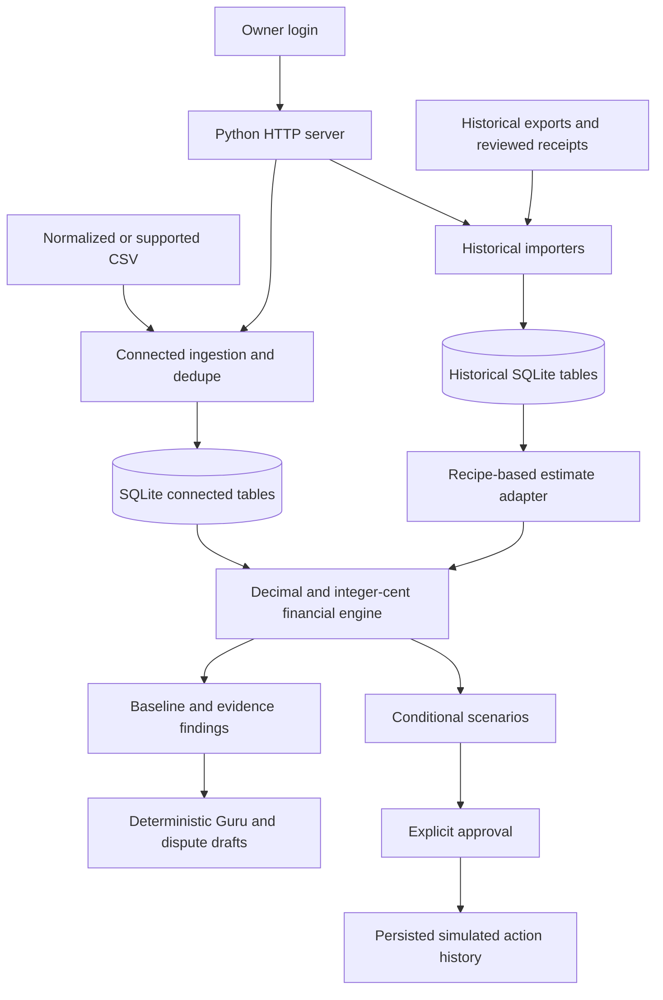

# ProfitShield

**Good food. Stronger margins.**

ProfitShield helps restaurant owners bring delivery payouts, POS sales and supplier
records into one place, inspect the evidence behind financial issues, and compare
what to do next. Built for the **NOVA 2026 DoorDash Back House challenge**.

The current app is an **authenticated local prototype** with a responsive
HTML/CSS/JavaScript interface, a Python backend and SQLite storage. Its connected
workflow runs without an AI key: code calculates the money, a deterministic Guru
explains the evidence, and the owner reviews any proposed action.

[Quick start](#quick-start) · [Features](#features) · [Demo](#try-the-demo) ·
[Import and financial rules](#import-format-and-financial-rules) ·
[Architecture](#architecture) · [Login and storage](#authentication-storage-and-reset) ·
[Configuration](#configuration) · [Integrations](#optional-integrations) ·
[Tests](#tests-and-verification) · [Troubleshooting](#troubleshooting)

## Project status

| Capability | Current behavior |
|---|---|
| Owner login | Working: local password setup/recovery, protected financial APIs, sessions, logout and CSRF protection. |
| CSV import | Working: normalized financial CSVs and supported platform/supplier exports, validation, duplicate detection and rejection reports. |
| Financial baseline | Working: backend Decimal/integer-cent calculations, contribution margin and missing-input reporting. |
| Findings and evidence | Working: supplied contract-rate checks, promotion review, fee patterns, supplier price observations and duplicate-document inquiries. |
| Connected Guru | Working deterministic explanation, using the same stored baseline and evidence. It is not a live LLM conversation. |
| Scenarios | Working conditional price, ingredient-cost and commission comparisons, with persisted results and assumptions. |
| Connected execution | **Simulated:** explicit approval, expiry, freshness and repeat checks; no external API or menu change. |
| Dispute preparation | Working owner-reviewed drafts and text download. No automatic submission or guaranteed recovery. |
| External AI | Optional, privacy-gated OpenRouter mapping, historical Q&A and receipt/PDF extraction. Provider contracts tested with mocks. |
| Square | Separate optional **sandbox-only** sync and reviewed actions. Tests use fake transport, not production credentials. |
| Hosted/multi-location use | Incomplete. Single-owner login is not organization/location isolation or production deployment readiness. |

## Quick start

### Requirements

- **Python 3.9+** with its standard `sqlite3`, `ssl`, `hashlib` and `zoneinfo` modules.
- **Git** to clone or update the repository.
- A modern browser.

There is no frontend build, npm install or application `requirements.txt` to run.
Node.js and Playwright are needed only for the optional test commands below.
Systems without an IANA time-zone database may need `tzdata`; see troubleshooting.

### 1. Get the code

For a fresh checkout:

```bash
git clone https://github.com/bhuvanakanakam/profitshield.git
cd profitshield
```

For an existing checkout, preserve any local changes first, then:

```bash
git fetch origin
git switch main
git pull --ff-only origin main
```

Stop an older running server with **Ctrl+C** before starting the updated app.

### 2. Set your owner password once

macOS/Linux:

```bash
python3 owner_auth.py bootstrap
```

Windows PowerShell:

```powershell
python owner_auth.py bootstrap
```

Choose a password of **14–1024 characters** and enter it twice. Terminal input is
hidden while typing. There is no default password. If an owner already exists,
use that password instead of bootstrapping again.

### 3. Start the server

macOS/Linux:

```bash
python3 server.py
```

Windows PowerShell:

```powershell
python server.py
```

Open **http://localhost:8000/#demo**, sign in, and select **Load example restaurant**.
Keep the terminal running while using the app. No `.env` file or provider key is
required for this flow.

To explicitly disable optional providers even if an existing `.env` contains keys:

```bash
# macOS/Linux
OPENROUTER_API_KEY='' SQUARE_ACCESS_TOKEN='' PROFITSHIELD_AI_PRIVACY_APPROVED='' python3 server.py
```

```powershell
# Windows PowerShell
# A space keeps the override present on older PowerShell versions; keys are trimmed.
$env:OPENROUTER_API_KEY=" "
$env:SQUARE_ACCESS_TOKEN=" "
$env:PROFITSHIELD_AI_PRIVACY_APPROVED="false"
python server.py
```

## Features

### Financial workspace: the connected workflow

This is the default `#demo` page. It uses a normalized dataset and connects six
steps around the same financial baseline:

1. **Import records.** Choose or drop a synthetic CSV. Review accepted records,
   skipped duplicates and rejected rows. Unknown costs remain unknown.
2. **Inspect findings.** Follow a commission discrepancy, promotion, recorded fee,
   invoice price change or duplicate document to its source evidence.
3. **Ask Guru.** Explain a finding using the same records and exact baseline.
   Responses are explicitly labelled deterministic; no external AI is used here.
4. **Compare scenarios.** Change uniform menu-price %, ingredient-cost % or
   commission percentage points. Inspect before/after amounts and assumptions.
5. **Review approval.** Propose a scenario and type `APPROVE SIMULATION ONLY`.
   The backend checks the baseline, ten-minute expiry and repeat submission.
   History becomes `Proposed → Approved → Simulated`, never externally Verified.
6. **Prepare a draft.** Review and download a conditional dispute or reconciliation
   inquiry. The owner decides whether and how to submit it.

Incomplete variable costs prevent a meaningful scenario. Existing scenarios and
proposals are tied to their original baseline; changed data requires recalculation.
Failures remain visible, and a failed refresh does not replace the last loaded
baseline with invented or fallback data.

### Historical books

The sidebar also preserves the original sample explorer:

| Page | Purpose |
|---|---|
| Overview | Reporting-week metrics, estimated contribution-margin bridge, evidence, trends and channel breakdown. |
| Money leaks | Historical findings and owner-entered open/disputed/handled status. Handling status is not independently verified recovery. |
| Workflow assistants | Ingestion, audit, explanation, simulation, execution review and dispute tools. These are workflows, not six independent background LLM agents. |
| Payouts | Delivery-order records filtered by channel, contract discrepancy, promotion or error charge. |
| Invoices | Supplier invoice observations and ingredient prices. Document copies are not proof of payments. |
| Menu & margins | Recipe-based cost and in-store/delivery margin estimates. |
| Connections | Historical CSV imports, mapping/deduplication/redaction reports, receipt review and optional Square sandbox controls. |

**There are two datasets.** Historical imports and the normalized Financial
workspace share a SQLite file but use separate tables. Uploading through
Connections updates historical books; uploading in Financial workspace updates
its normalized records. Neither upload silently populates the other experience.

Historical estimates use recipe-based food consumption and assume unreported
refunds and other variable costs are zero. The normalized workspace does **not**
fill missing costs with zero. Neither should be presented as complete accounting
profit without the required inputs.

### Interface and usability

- Responsive workspace, historical dashboards and styled owner login.
- Light sage primary buttons with dark text, visible focus and reduced-motion support.
- **How it works** tour and a keyboard skip link.
- Evidence drawers with keyboard focus containment and return.
- Explicit empty, incomplete-data, loading, error and retry states.
- Receipt inputs stay available after a failed save; corrected imports can be retried.
- Draft downloads and persisted scenarios/action histories.

See the [user guide](docs/USER_GUIDE.md) for each page and control.

## Try the demo

### Reference numbers

Select **Load example restaurant** after signing in. The four synthetic financial
rows in [`demo_data/golden.csv`](demo_data/golden.csv) reconcile to:

| Component | Amount |
|---|---:|
| Gross sales | $10,000.00 |
| Refunds | −$300.00 |
| Restaurant-funded promotions | −$500.00 |
| **Net sales** | **$9,200.00** |
| Commissions | −$1,500.00 |
| Food costs | −$2,800.00 |
| Other variable costs | −$200.00 |
| **Contribution margin** | **$4,700.00** |
| **Contribution-margin rate** | **51.09%** |
| Accounting profit | Unavailable: operating expenses incomplete |

The $100 platform-funded promotion is informational; it is not another deduction.
The $100 commission discrepancy is already included in commission costs; it is
not subtracted twice.

### A short walkthrough

1. Load the example and inspect the financial-baseline disclosure.
2. Open commission finding evidence for `DoorDash:G-DD`: $4,000 gross, a supplied
   20% gross-sales contract rate, and $900 charged versus $800 expected.
3. Select **Explain finding**. Guru shows the same $4,700 margin and a **$100
   conditional exposure**, not recovered money.
4. Calculate the default **5% price-change scenario**: $5,127.50 contribution
   margin, a **$427.50 conditional improvement on this dataset**.
5. Propose it, review the assumptions, and approve the simulation with the exact phrase.
6. Prepare/download the commission draft. Compare the duplicate-document inquiry:
   it has no established payment claim.
7. Reload to see persisted data. Import `golden.csv` again: four duplicate rows
   are skipped and the baseline is unchanged.

The scenario holds demand and quantities constant and keeps refunds/promotions
fixed in dollars. It is not a forecast, realized saving, or weekly/annual promise.
See [DEMO_SCRIPT.md](DEMO_SCRIPT.md) for the narrated judge journey.

### Sample files

| Location | Use |
|---|---|
| [`demo_data/golden.csv`](demo_data/golden.csv) | Complete four-row normalized reference for Financial workspace. |
| [`demo_data/documents.json`](demo_data/documents.json) | Structured synthetic supplier observations loaded with the example. These are not a newly performed OCR extraction. |
| [`demo_data/edge_cases.json`](demo_data/edge_cases.json) | Isolated missing-value, adjustment, duplicate and repeated-fee test cases. |
| [`samples/`](samples/) | Historical DoorDash, Uber Eats, Grubhub, Square and supplier exports; 1,776 seeded orders across four weeks. |
| [`samples/grubhub_export_unusual_columns.csv`](samples/grubhub_export_unusual_columns.csv) | Historical mapping/redaction/dedupe example. Reimport adds no orders and reports 100 personal fields removed. |
| [`samples/receipt_restaurant_depot_2026-10-30.jpg`](samples/receipt_restaurant_depot_2026-10-30.jpg) | Synthetic receipt image for optional extraction. **Use sample receipt** demonstrates pre-read line review without AI. |
| [`samples/sysco_invoice_SY-88214.pdf`](samples/sysco_invoice_SY-88214.pdf) | Synthetic multi-page invoice for optional privacy-approved extraction. |

These files are visible in the repository, not exposed as arbitrary files by the
application's HTTP server.

## Import format and financial rules

### Normalized CSV

Use [`demo_data/golden.csv`](demo_data/golden.csv) as the starting template. These
headers must be present; financial cells may be empty when genuinely unknown:

```text
id,source,date,channel,gross_sales,refunds,restaurant_promotions,platform_promotions,commissions,other_platform_fees,food_costs,other_variable_costs
```

| Field | Meaning |
|---|---|
| `id` | Transaction identifier, unique within its channel. |
| `source` | Provenance reference, such as a filename and row number. |
| `date` | ISO date, `YYYY-MM-DD`. |
| `channel` | `DoorDash`, `Uber Eats`, `Grubhub`, or `In-store`. |
| Financial fields | Dollar amounts with at most two decimal places. Empty means unknown, not zero. |
| `contract_rate` | Optional fraction such as `0.20`; required for applicable commission checks and commission-sensitive delivery scenarios. |
| `contract_basis` | Optional `gross_sales` or `net_sales`; defaults to `gross_sales`. |
| `promotion_approved` | Optional boolean `true`/`false`; defaults to false if the column is omitted. Use an explicit boolean when supplied. |
| `fee_reason` | Optional text used to group recorded/repeated platform fees. |

Connected CSV uploads are limited to **4 MiB** and **20,000 input rows**. Unknown
layouts must be converted to normalized CSV; the connected import path does not
invoke an LLM. Known platform exports can lack refunds, food consumption, complete
variable costs or contract terms, so importing them may leave margin unavailable.

Identical transactions are deduplicated by channel/ID and financial content, not
just filename. A conflicting duplicate is rejected rather than silently replacing
stored data. Supplier CSVs can add invoice observations without transaction rows;
transaction records are needed before requesting explanations or drafts.

### Definitions

Normalized amounts are validated as finite dollar inputs, converted to integer
cents, and calculated using `Decimal` and **half-up** rounding. Contractual
commission rounds per transaction. Historical recipe estimates round at the period
total; historical item-price increments round per channel and sum those cents.

```text
Net sales = Gross sales − Refunds − Restaurant-funded promotions

Contribution margin = Net sales − Commissions − Other platform fees
                      − Food costs − Other variable costs

Contribution-margin rate = Contribution margin / Net sales × 100

Accounting profit = Contribution margin − Complete operating expenses
```

- Gross excludes tax/tips and must not already be net of separately supplied deductions.
- Costs/refunds are positive deductions; negative costs represent credits.
- Platform-funded promotions are informational under the normalized schema.
- Suspected overcharges are a subset of commission, not another margin deduction.
- Food purchases on an invoice do not establish food consumption or payment.
- Duplicate documents do not establish duplicate payments and never reduce margin.
- Missing required inputs make the affected result unavailable. A zero net-sales
  denominator makes the margin percentage unavailable.
- Suspected exposures can overlap; do not sum them as guaranteed recoveries.

The Python calculation function accepts complete operating expenses separately;
the current UI does not collect them. Source semantics and supplied contract terms
still require owner review. The app cannot infer that a mislabeled gross figure
was already netted elsewhere.

## Architecture



### Repository structure

| Path | Responsibility |
|---|---|
| [`index.html`](index.html) | Entire responsive frontend: navigation, charts, forms, evidence/review panels, assistant and help. No frontend framework/build step. |
| [`server.py`](server.py) | Standard-library HTTP service, APIs, database setup, historical imports, optional integrations, session/CSRF enforcement and asset allowlist. |
| [`owner_auth.py`](owner_auth.py) | Owner bootstrap/recovery, password hashing, session storage, expiry, login throttling and login screen. |
| [`financial_engine.py`](financial_engine.py) | Canonical normalized validation, cent totals, commission checks, findings and scenarios. |
| [`prototype.py`](prototype.py) | Connected ingestion and persisted baseline/scenario/proposal/action/draft workflows. |
| [`legacy_finance.py`](legacy_finance.py) | Historical recipe-based estimates and explicit missing-cost assumptions. |
| [`input_security.py`](input_security.py) | Request bounds, allowed fields/values, date/number validation, route lists and throttling. |
| [`square_actions.py`](square_actions.py) | Separate expiring, one-use review plans for sandbox operations. |
| [`tests/`](tests/) | Unit, HTTP, import, integration, financial bridge and browser regression tests. |
| [`.github/workflows/tests.yml`](.github/workflows/tests.yml) | Python/Node CI and development-branch policy. |

### API groups

Use the authenticated browser session. Financial reads require a valid session;
POST operations additionally require JSON, the exact configured Origin and its
session-specific `X-CSRF-Token`. Login creates a session; its request has no prior
session/CSRF requirement but still enforces origin and bounded JSON.

| Routes | Responsibility |
|---|---|
| `GET /api/health` | Health; anonymous responses omit integration details. |
| `POST /api/auth/login`, `GET /api/auth/session`, `POST /api/auth/logout` | Login, session/CSRF information and logout. |
| `GET /api/data` | Historical records and server-provided financial model. |
| `POST /api/import`, `/api/invoices`, `/api/extract` | Historical CSV import, reviewed invoice save and optional image/PDF extraction. |
| `POST /api/ask`, `/api/simulate` | Historical assistant and backend item-price calculation. |
| `GET /api/prototype` | Persisted connected workspace, baseline, findings, scenarios, actions and drafts. |
| `POST /api/prototype/load-golden`, `/api/prototype/reset`, `/api/prototype/import` | Example loading, connected reset and normalized/supported CSV import. |
| `POST /api/prototype/guru`, `/api/prototype/simulate` | Connected explanations and scenarios. |
| `POST /api/prototype/propose`, `/api/prototype/approve`, `/api/prototype/dispute` | Proposal, explicitly simulated approval and conditional draft preparation. |
| `POST /api/square/sync` | Optional Square sandbox order sync. |
| `POST /api/menu/preview` → `/api/menu/apply` | Separate reviewed sandbox menu-price operation. |
| `POST /api/square/seed/preview` → `/api/square/seed` | Separate review and confirmation for three sandbox test orders. |
| `POST /api/reset` | Whole restaurant-database reset, not the connected Reset demo button. |

## Authentication, storage and reset

Passwords are hashed with **scrypt**. Session tokens are generated randomly and
stored only as hashes. Cookies are **HttpOnly** and **SameSite=Strict**; HTTPS uses
**Secure** cookies. Sessions expire after **30 minutes idle** or **12 hours total**.
Repeated failed logins are throttled. Sign out revokes the current session.

Plain HTTP authentication is permitted only on a loopback origin. Remote HTTP is
rejected. The server binds to `127.0.0.1`; HTTPS cookie support alone does not turn
this into a configured production deployment. There is no remote signup, default
password or remote password-recovery endpoint.

For a forgotten owner password, run locally:

```bash
python3 owner_auth.py recover
```

This intentionally revokes every session. On Windows, substitute `python`.

Default storage:

| File/table group | Contents |
|---|---|
| `backhouse.db` | Restaurant data and imported historical records. Created/seeded on first start. |
| `prototype_state` | Bounded normalized rows and supplier observations as JSON in the restaurant database. |
| `prototype_scenarios`, `prototype_actions`, `prototype_disputes` | Connected scenarios, simulated action history and drafts. |
| Historical tables | Orders, errors, invoice lines, mappings, import reports, menu references and separate Square review plans. |
| `owner-auth.sqlite3` | Separate owner password hash, session hashes and login-attempt state. |

Connected financial records use integer-cent values; historical tables retain
source values and the adapter constructs cent-based estimates. Schema creation
is additive/idempotent; existing restaurant tables are preserved.

| Action | What it resets |
|---|---|
| **Refresh** | Reloads saved state; does not reset data. |
| **Reset demo** | Connected records, scenarios, actions and drafts after confirmation. Historical books and owner password remain. |
| **Load example restaurant** | Replaces connected state/history with the synthetic reference, after confirmation when data already exists. |
| `POST /api/reset` | Whole restaurant database, including connected tables, followed by historical reseeding. Authentication storage is separate. |
| Owner password recovery | Password and sessions; restaurant records remain. |

Reloading preserves connected records/scenarios/actions/drafts. Guru explanation
text is transient and can be generated again. Historical handled/disputed UI status
is browser-local; it is not a verified external ledger.

## Configuration

`.env` is optional. For a new local configuration, copy [`.env.example`](.env.example)
to `.env` and edit it; keep an existing `.env` rather than overwriting it. Exported
environment variables take precedence over `.env` values read by the server.
Never commit keys, financial databases or authentication storage.

| Variable | Default / purpose |
|---|---|
| `PORT` | `8000`. |
| `PROFITSHIELD_ORIGIN` | `http://localhost:<PORT>`. Must exactly match the browser origin for writes. |
| `BACKHOUSE_DB` | `backhouse.db` in the repository. Optional alternative restaurant-data path. |
| `PROFITSHIELD_AUTH_DB` | `owner-auth.sqlite3` in the repository. Export the same path for bootstrap/recovery and server, or use CLI `--db`. |
| `PROFITSHIELD_LOCAL_HTTP` | Automatically enabled for HTTP localhost/127.0.0.1. Explicit `1` still cannot authorize remote HTTP. HTTPS defaults to secure-cookie mode. |
| `STORE_TZ` | `America/New_York`. Requires time-zone data on the host. |
| `OPENROUTER_API_KEY` | Empty/off unless configured. |
| `OPENROUTER_MODEL` | `google/gemini-2.5-flash`; optional mapping/Q&A model. |
| `OPENROUTER_VISION_MODEL` | Defaults to `OPENROUTER_MODEL`; optional receipt/PDF model. |
| `PROFITSHIELD_AI_PRIVACY_APPROVED` | Off unless set to `true` after owner-approved privacy policy. |
| `SQUARE_ACCESS_TOKEN` | Empty/off unless a **sandbox** token is configured. |
| `SQUARE_VERSION` | `2024-10-17`; Square API version header. |
| `SQUARE_ENV` | Cannot select production; transport remains pinned to the sandbox endpoint. |

For example, a different local port on macOS/Linux:

```bash
PORT=8001 python3 server.py
```

PowerShell:

```powershell
$env:PORT="8001"
python server.py
```

Open `http://localhost:8001/#demo`. If `PROFITSHIELD_ORIGIN` was explicitly set
elsewhere, update it to match. If browsing with `127.0.0.1`, configure that exact
origin instead of `localhost`.

## Optional integrations

### OpenRouter

The historical path supports optional unfamiliar-column mapping, tool-based Q&A
and receipt/image/PDF extraction. Configure a compatible model/key and set
`PROFITSHIELD_AI_PRIVACY_APPROVED=true` only after privacy approval.

Redaction is best effort, not proof that a document is safe to transmit. Use
synthetic fixtures for development; do not send real records before approval.
Extracted receipt lines still require owner review. The pre-read sample receipt
needs no key. Enabling OpenRouter does **not** turn the connected Guru into a
live LLM: that separate workflow remains deterministic.

### Square sandbox

Configure a Square **sandbox** access token to sync sandbox orders. Test-order
creation and catalog changes require a reviewed plan and exact confirmation:

- `CREATE 3 SANDBOX ORDERS` for the reviewed test baskets.
- `APPLY SANDBOX PRICES` for a reviewed price plan.

Plans expire after five minutes and are claimed once before an external write.
Stale, repeated and ambiguous outcomes are not automatically retried. This is a
separate integration from the connected workspace's ten-minute simulated proposal.
Production endpoints/credentials are not supported. Delivery-app menu edits and
dispute submission remain manual; no live delivery-platform API is connected.

## Tests and verification

Application use requires Python only. Tests additionally use **Node.js 24**;
optional browser checks need Playwright for Python and Chromium installed.

```bash
python3 -m unittest discover -s tests -v
node --test tests/js/*.test.cjs
```

Optional end-to-end/browser checks:

```bash
python3 tests/browser_prototype.py
python3 tests/browser_owner_auth.py
python3 tests/browser_input_security.py
python3 tests/browser_square_guard.py
python3 tests/browser_final_ui.py
```

Final application verification recorded **112 passing Python tests, seven passing
JavaScript tests, and five passing browser journeys**. GitHub CI passed Python
3.9, Python 3.12 and Node for the final UI/login code. See the
[verification record](docs/FINAL_VERIFICATION.md) and
[successful CI run](https://github.com/bhuvanakanakam/profitshield/actions/runs/42419891051).

Coverage includes real CLI startup with temporary storage, login/logout/expiry,
anonymous API denial, CSRF, financial fixtures, imports/dedupe/redaction, receipt
save retry, evidence, scenarios, approval freshness/repeats, draft download,
persistence/reset, stored-input escaping, failed-backend recovery, keyboard
controls and all eight pages at 390/768/1024/1440px.

Tests use temporary databases and synthetic data. External AI/Square transports
are mocked or blocked; no real provider write or live AI run is claimed. Browser
checks are currently local, not part of the GitHub Actions installation/job.
Accessibility checks are partial, not a full WCAG or screen-reader certification.

For opt-in screenshots:

```bash
PROFITSHIELD_UI_SCREENSHOTS=/tmp/profitshield-ui python3 tests/browser_final_ui.py
```

See [tests/README.md](tests/README.md) for fixtures and detailed commands.

## Troubleshooting

| Problem | What to check |
|---|---|
| `python3` is not found | On Windows try `python` or `py`; install Python 3.9+ if needed. |
| `ZoneInfoNotFoundError` | Your host may lack IANA time-zone data. Install it with `python -m pip install tzdata` (use `python3` where appropriate), then restart. |
| Owner already exists | Use the existing password. Run local `owner_auth.py recover` only to intentionally replace it and revoke sessions. |
| Sign-in fails | Check the password and that bootstrap/server use the same auth database. After repeated attempts, wait a minute before retrying. |
| Address/port already in use | Stop the older server with Ctrl+C, or select another `PORT` and matching browser origin. |
| A write returns 403 | Use the exact configured origin, including hostname/port. Sign in again if needed. Browser POSTs carry the session CSRF token. |
| New UI is missing | Confirm `git branch --show-current` is `main`, pull updates, restart the Python server and reload the browser. |
| Margin is unavailable | Inspect missing inputs. Known platform exports may not contain refunds or all variable costs; missing does not mean zero. |
| Import changed a different page | Financial workspace and historical Connections imports target separate datasets. |
| Simulation/proposal is stale | Recalculate against current data and create a fresh proposal. Do not retry an expired or consumed approval. |
| AI or receipt extraction is unavailable | The core demo still works. External features need both a configured key and privacy approval. |
| Square is not connected | The connected simulation needs no Square token. For optional integration, use sandbox credentials only. |
| The database cannot load | Check the visible error and storage permissions. Use Retry connection; the UI does not silently replace failed live data with a demo. |

## Development and documentation

Start normal tasks from the latest `development`, use a focused working branch,
and target `development` in task PRs. Main promotion/release requires separate
approval; there is no automatic merge or deployment. Read
[AGENTS.md](AGENTS.md) and [docs/DEVELOPMENT.md](docs/DEVELOPMENT.md).

- [User guide and backend responsibilities](docs/USER_GUIDE.md)
- [Current UI/login verification and limits](docs/FINAL_VERIFICATION.md)
- [Narrated demo script](DEMO_SCRIPT.md)
- [Tests and fixture documentation](tests/README.md)
- [Historical initial-prototype verification](DEMO_VERIFICATION.md)

Remaining work includes complete operating-expense collection, payment
reconciliation, stronger source/contract validation, organization/location
isolation, deployment hardening and owner pilots. SQLite JSON state and in-process
locking serve a local single instance; they are not a horizontally scaled ledger.
Real financial records and production platform actions are outside the tested
synthetic demo.
