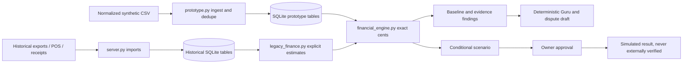

# What is happening in ProfitShield

Review snapshot: November 7, 2026. This is a branch/code review and local test
comparison, not a production security audit. All five currently advertised
upstream branch heads were inspected. The review did not modify the application
branches or merge any PR. Local results below use Python 3.12; GitHub's Python
3.9 status is reported separately, not inferred from local tests.

## The project in plain English

ProfitShield helps a restaurant owner combine delivery payout reports, POS sales
and supplier evidence, understand the available financial picture, inspect
suspected issues, and compare a next action. It is a local Python/SQLite app with
a plain HTML/CSS/JavaScript frontend, not a React/Next.js application. No npm build
or application pip install is required.

There are **two product experiences** in the same codebase:

1. **Historical explorer:** Overview, Money leaks, Agents, Payouts, Invoices,
   Menu & margins, and Connections. It seeds 1,776 synthetic orders across four
   reporting weeks and reads historical platform/supplier formats. Its margin is
   an estimate: food is estimated from recipes and supplier prices; unreported
   refunds/other costs are assumed zero in the adapter. It is not accounting profit.
2. **Connected financial workspace (`#demo`):** a separate normalized dataset with
   explicit inputs for refunds, promotions and variable costs. It connects ingest,
   evidence, deterministic Guru, scenario, approval and dispute-draft operations
   through one exact-cent calculation engine. Four synthetic reference rows make
   it easy to demonstrate and reconcile. Unknown costs remain unavailable.

These experiences share a server and SQLite file but use different tables.
Loading/resetting the connected example does not delete the historical samples.
An import in one experience should not be assumed to update the other experience.

## The branch map

| Branch | Inspected head | What it contains | What to do with it |
|---|---|---|---|
| `main` | `2b6cd6a` | Older explorer plus merged auth/input/file/security/test work. No `financial_engine.py` or connected `prototype.py`. | Default GitHub view, not the new demo. Do not present it as containing the redesign. |
| `development` | `5ed85b8` | Connected prototype + exact-cent engine, merged main history, plus two later commits. Current integration head has runtime/test/auth gaps. | Intended integration base, but not currently the tested demo candidate. |
| `feat/uiux-latest` | `7c5b6c6` | Connected demo + redesigned UI + owner-auth integration restoration. | Best demo candidate among these inspected heads; use this exact branch when testing. |
| `fix/ci-owner-auth-and-startup` | `6a52359` | Four small startup/test-helper fixes on current development. PR #11 is open against development. | Helps setup, but does not restore all removed auth routes/checks; Python CI remains red. |
| `revert-6-upstream/fix/04-square-sandbox-guard` | `979450e` | Historical revert branch already merged through PR #7. | History, not the next integration target. Do not restart feature work from it. |

`origin/HEAD` is an alias pointing at `main`, not a sixth independent branch.
The earlier local `feat/frontend-experience` (`5bdf10e`) is an obsolete first UI
attempt; the pushed replacement is `feat/uiux-latest`.

At review, UI and development have diverged from `3aacf07`: each has two unique
commits. UI is not missing the connected prototype; it shares that common base.
The later development changes are a route-list expansion and an incomplete
startup adjustment. The route list already has an additive update at the bottom
of `input_security.py`; inspect the whole file before claiming missing routes.
The CI-fix branch is four commits ahead of development. Its fixes overlap the
repair already in the UI branch. Review differences before merging both.

## Why history looks tangled

The initial application was followed by file isolation, input validation, tests,
owner login and Square review-guard work, often on a collaborator's fork.
PR #6 added sandbox review protection; PR #7 reverted that change on main.
Later PRs reconciled multiple code paths, and some guards were restored in the
resulting code. Current behavior must be read from each head, not deduced from a
PR title or one revert alone.

PR #9 merged the connected financial prototype into development. Commit
`3aacf07` then merged main into development. Partial integration left auth
references without complete dispatch. The UI branch restored that dispatch;
the later CI-fix branch fixes only some mechanical errors.

PR #10 (`development` → `main`) is closed **without merging**. That is why main
still lacks the connected demo. PR #11 is open against development. The UI branch
was pushed but had no review PR in the inspected PR list.

## The code map

| File or folder | Responsibility |
|---|---|
| `index.html` | Entire frontend: styles, SVG icons, navigation, tables, assistant/evidence/review panels, historical visualizations, connected workflow renderer. Vanilla JavaScript calls the HTTP APIs. |
| `server.py` | Python standard-library HTTP service, SQLite connection/schema, historical CSV import/redaction/mapping, invoice saves, optional OpenRouter tools, guarded Square operations, API dispatch and security headers. |
| `financial_engine.py` | Canonical normalized calculation/validation: integer cents and Decimal, contract-based commission discrepancy, evidence findings, conditional scenarios. No LLM does this arithmetic. |
| `prototype.py` | Connected workflow state in four `prototype_*` SQLite tables: ingest, load/reset example, Guru, scenarios, proposals, approvals, and dispute drafts. No external AI or platform writes in this path. |
| `legacy_finance.py` | Adapts historical orders/recipes/invoices into server-calculated estimates using the canonical engine. Assumptions differ from the complete normalized demo. |
| `owner_auth.py` | Single-owner password bootstrap/recovery, scrypt hashing, stored session-token hashes, expiration, login throttling, cookie/session/CSRF support. Not a multi-user organization model. |
| `input_security.py` | Bounded JSON/CSV/upload structures, finite numbers, dates/choices, route allowlists, same-origin validation and rate limiting. |
| `square_actions.py` | Durable, expiring one-use sandbox review plans. Claim a plan before a write; reject stale/repeated approvals. Separate from connected simulated actions. |
| `samples/` | Historical synthetic platform exports, supplier data and receipt assets. |
| `demo_data/` | Four-row golden reference CSV, structured invoice evidence, isolated financial edge-case fixtures. |
| `tests/` | Python financial/import/security/integration tests; Node frontend/backend bridge tests; optional browser journeys. External transports mocked or blocked. |
| `.github/workflows/tests.yml` | PR/manual CI: development-base policy, Python 3.9/3.12, Node/data bridge. Does not run browser checks or deploy the app. |
| `AGENTS.md`, `docs/DEVELOPMENT.md` | Contributor rules: branch from development, task PRs target development, no automatic main promotion/merge/deployment. |

The module names “Guru”, “Auditor”, “Simulation”, etc. identify workflows. They
are not evidence of six independent autonomous LLM agents or scheduled jobs.
The current connected Guru is explicitly deterministic.

## Data flow

Important API groups:

- `/api/auth/login`, `/api/auth/session`, `/api/auth/logout`: owner session lifecycle.
- `/api/data`: historical records + server financial model.
- `/api/import`, `/api/invoices`, `/api/extract`: historical ingest/review path.
- `/api/prototype` and `/api/prototype/{import,guru,simulate,propose,approve,dispute}`:
  connected baseline and workflow.
- `/api/prototype/load-golden`, `/api/prototype/reset`: synthetic demo lifecycle.
- `/api/simulate`: historical item-price calculation, not an external write.
- `/api/menu/preview` → `/api/menu/apply` and Square seed review endpoints:
  separate reviewed sandbox integration; never production Square.

## What the numbers mean

Golden reference: $10,000 gross − $300 refunds − $500 restaurant promotions =
$9,200 net sales. Deduct $1,500 commission, $2,800 food and $200 other variable
costs: **$4,700 contribution margin**, or **51.09% of net sales**. Operating
expenses are incomplete, so accounting profit is unavailable.

The $100 platform-funded promotion is informational. The $100 commission
exposure is already included in commission; deducting it again would double count.
Two supplier invoice copies do not establish two payments.

The 5% price scenario gives **$5,127.50 contribution margin**, a **$427.50**
conditional improvement on the reference dataset. Demand/quantity stay fixed;
refunds and promotions stay fixed in dollars. This is not realized savings,
weekly revenue, an annual forecast, or evidence that a platform price changed.

The old README/demo story “sales up 12%, profit down $574” used an unsupported
$737.80 duplicate-payment deduction. The connected-prototype correction removes
that deduction; corrected historical estimated margin change is **+$164.03**.
Do not mix the original narrative with corrected current calculations.

## Tests I ran or verified

| Head | Local Python result | Interpretation |
|---|---|---|
| `main@2b6cd6a` | 84 tests, pass | Passing older behavior. Does not establish correctness of newer connected flows or validate old financial claims. |
| `development@5ed85b8` | 44 tests reached, five setup errors | `OwnerAuth` is missing from shared fixture imports; affected test classes cannot start. This is not “only five tests failing.” |
| `fix/ci-owner-auth-and-startup@6a52359` | 107 tests, 87 failures and seven errors (includes subtests) | Setup proceeds, then auth/status/Origin expectations still fail. |
| `feat/uiux-latest@7c5b6c6` | 108 tests, pass; seven Node tests pass | Owner-auth restoration plus new negative coverage; local evidence, not a claim that its PR CI ran. |

PR #11 GitHub check snapshot: Development branch policy passes; Node/data bridge
passes; Python 3.9 and Python 3.12 fail. No browser job runs in CI.

UI branch browser evidence: connected golden journey, exact scenario/approval,
disputes, dedupe, state after reload, reset, XSS text rendering, focus/table checks,
and 390/768/1024/1440px overflow checks pass. Separate login/logout/expiry/live-error
and fake-Square review browser checks pass. This is not a full accessibility,
security, performance or real-integration certification.

## The important current issues

1. **Development startup is broken at the inspected head.** It constructs a
   `ThreadingHTTPServer` without assigning `httpd`, then references `httpd`.
   The CI-fix branch assigns it correctly; the UI branch already does so.
2. **Development `_json` references an undefined `cookie`.** Its signature lost
   `cookie=None`. The CI-fix and UI branches repair this mechanical defect.
3. **The CI-fix branch does not complete auth integration.** Its GET dispatch
   computes `authenticated` but does not enforce it before financial APIs; the
   session and login/logout dispatch is incomplete and POST checks use the other
   origin path. The UI branch restores the main-branch session/CSRF behavior.
4. **Documentation describes different historical states.** Some inherited
   verification text says owner auth is absent or uses the old Load button label.
   Use the UI branch's README launch steps and actual code, not every historical
   document as current truth.
5. **Public/production readiness remains incomplete.** One owner and local SQLite
   are not organization/location isolation. Missing costs, payment reconciliation,
   inventory/labor/expense accounting and owner validation remain future work.

## What I recommend next

- For judging: keep testing `feat/uiux-latest` and freeze an exact commit when ready.
- For integration: review a UI → development PR, compare overlapping fixes with
  PR #11, preserve both the later server-close behavior and complete auth controls,
  and rerun CI + browser journeys on the combined result. Do not blindly merge
  branch histories or change security checks to satisfy stale tests.
- Correct stale demo/run instructions in the integrated branch.
- Promote development to main only through a separately reviewed release step.
- After the hackathon: separate the large frontend into modules, complete financial
  inputs and payment reconciliation, add tenant isolation, then evaluate external
  AI with privacy approval. These are recommendations, not work completed here.

## References

- Branches: https://github.com/bhuvanakanakam/profitshield/branches
- UI: https://github.com/bhuvanakanakam/profitshield/tree/7c5b6c6
- Integration: https://github.com/bhuvanakanakam/profitshield/tree/5ed85b8
- Fix PR: https://github.com/bhuvanakanakam/profitshield/pull/11
- Closed promotion PR: https://github.com/bhuvanakanakam/profitshield/pull/10
- Connected prototype PR: https://github.com/bhuvanakanakam/profitshield/pull/9
- Fix CI: https://github.com/bhuvanakanakam/profitshield/actions/runs/42417292007
